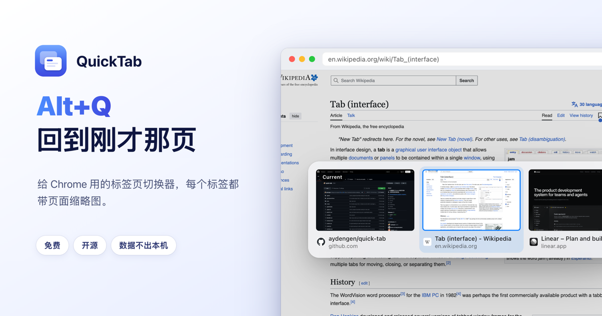

# QuickTab

一个用快捷键在最近访问的标签页之间切换的 Chrome 扩展。

**用法：** 按 `Alt+Q` 打开切换面板；按住 `Alt` 并连按 `Q` 选择标签页，松开 `Alt` 即可切换。

[Chrome Web Store 安装](https://chromewebstore.google.com/detail/quicktab/pmagocpnoedekbpchligfnhkimheklaj) · [官网](https://aydengen.github.io/quick-tab/)

许可证：[MIT](LICENSE)
